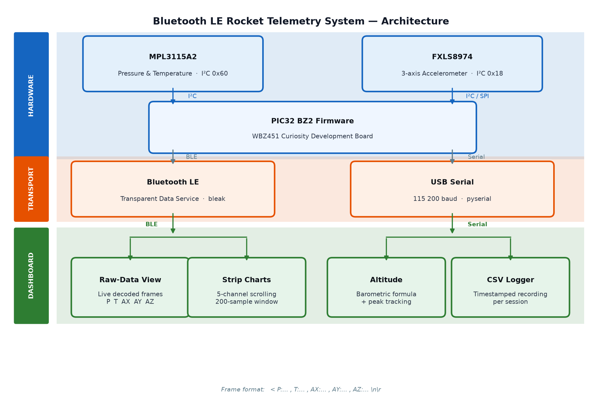
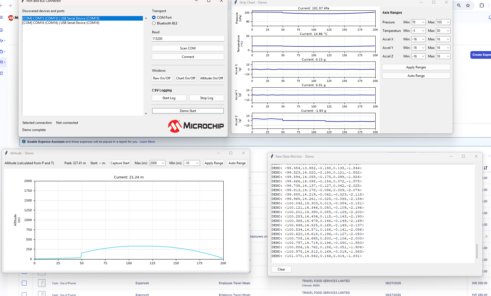

# Bluetooth LE Rocket Telemetry System Using PIC32 BZ2 MCUs

[](https://www.microchip.com/en-us/products/microcontrollers/32-bit-mcus/pic32-sam/pic32-bz2)
[](https://www.microchip.com/en-us/products/wireless-connectivity/bluetooth-low-energy)
[](https://www.python.org/)


**Real-time wireless sensor telemetry using the PIC32 BZ2 family, with pressure, temperature and three-axis acceleration displayed through a Python desktop dashboard over Bluetooth LE or serial.**

> Engineering demonstration and development reference for real-time wireless sensor telemetry. Validate the complete hardware, firmware, radio and mechanical system before use in any field test. This project is not a certified flight-control or safety system.

## Table of Contents

- [Overview](#overview)
- [System Architecture](#system-architecture)
- [Hardware and Software](#hardware-and-software)
- [Repository Organization](#repository-organization)
- [Telemetry Data Format](#telemetry-data-format)
- [Firmware Setup](#firmware-setup)
- [Desktop Dashboard Setup](#desktop-dashboard-setup)
- [Running the Demonstration](#running-the-demonstration)
- [Troubleshooting](#troubleshooting)
- [Frequently Asked Questions](#frequently-asked-questions)
- [References](#references)

## Overview

The embedded application uses the PIC32 BZ2 family to acquire pressure and temperature data from an MPL3115A2 and three-axis acceleration data from an FXLS8974. The demonstrated hardware uses the WBZ451 Curiosity Development Board. Sensor data is formatted by the firmware and made available through a Bluetooth LE transparent data service or a serial connection.

The Python desktop dashboard receives the sensor data, displays a raw-data view and real-time charts, calculates altitude from pressure and temperature, tracks peak altitude, and records measurements to CSV. The dashboard is primarily validated on Windows. macOS and Linux may also be supported, but they have not been formally validated for this project.

The PIC32 BZ2 family is also available in a high-output-power variant for applications that require longer-range wireless measurements. The family supports 2M PHY for higher-throughput operation and LE Coded PHY for extended-range operation.

## Key Capabilities

- Pressure and temperature acquisition using the MPL3115A2
- Three-axis acceleration acquisition using the FXLS8974
- Bluetooth LE and serial telemetry transport
- Live raw-data monitoring
- Five-channel strip charts for pressure, temperature, AX, AY and AZ
- A 200-sample rolling chart window
- Configurable chart ranges and Auto Range scaling
- Altitude calculation from pressure and temperature
- Launch-site baseline capture and peak-altitude tracking
- Timestamped CSV data logging without overwriting earlier logs
- Hardware-independent Demo Mode with a simulated 20-second flight profile

## System Architecture



## Hardware and Software

### Hardware Components

| Component | Part / Platform | Role |
|---|---|---|
| Wireless MCU development board | WBZ451 Curiosity Development Board | Runs the PIC32 BZ2 firmware, reads the sensors and provides Bluetooth LE or serial telemetry |
| Pressure and temperature sensor | MPL3115A2, I2C address `0x60` | Measures barometric pressure and temperature |
| Three-axis accelerometer | FXLS8974, I2C address `0x18` | Measures acceleration on the X, Y and Z axes; configured for a ±2 g range and 12.5 Hz output data rate |
| I2C connection | Shared sensor bus | Connects both sensors to the development board; requires appropriate power, ground, wiring and pull-ups |
| Host computer | Windows PC primarily; macOS or Linux potentially supported | Runs the Python desktop dashboard |
| Bluetooth adapter | Bluetooth 4.0 or later | Provides Bluetooth LE connectivity when the host does not include a compatible adapter |
| Serial interface | Compatible USB-to-UART bridge, when required | Provides the wired telemetry connection at 115200 baud |
| Programming connection | USB | Connects the development board to the development host |

The table below lists the I2C connections between the WBZ451 Curiosity Development Board and the two sensors. Confirm the exact pin numbers against the WBZ451 Curiosity Board schematic and the firmware I2C peripheral configuration before wiring.

| Signal | WBZ451 Curiosity Pin | MPL3115A2 | FXLS8974 | Notes |
|---|---|---|---|---|
| 3.3 V | 3.3 V supply | VDD (pin 8) | VDD (pin 1) | Both sensors require a 3.3 V supply |
| GND | GND | GND (pin 5) | GND (pin 8) | Common ground |
| SCL | I2C clock (verify pin) | SCL (pin 3) | SCL (pin 2) | 4.7 kΩ pull-up to 3.3 V required |
| SDA | I2C data (verify pin) | SDA (pin 4) | SDA (pin 3) | 4.7 kΩ pull-up to 3.3 V required |
| INT | GPIO (optional) | INT1 (pin 6) | INT1 (pin 5) | Interrupt output; leave unconnected if polling is used |

Both sensors share the same I2C bus. The MPL3115A2 uses address `0x60` and the FXLS8974 uses address `0x18`. Confirm the pull-up resistor values against the actual bus capacitance and clock frequency used in the firmware.

At startup, the firmware verifies both sensors through their identity registers. The expected identity value is `0xC4` for the MPL3115A2 and `0x86` or `0x84` for the FXLS8974. If either sensor is not detected, the firmware reports the failure and stops sensor polling gracefully.

### Firmware Software Stack

| Component | Details |
|---|---|
| Language | C |
| Framework | MPLAB Harmony 3 |
| RTOS | FreeRTOS |
| IDE | MPLAB X IDE |
| Compiler | XC32 |
| Target family | PIC32 BZ2 |
| Demonstrated board | WBZ451 Curiosity Development Board |

Install tool, device-pack and Harmony component versions that match the firmware project configuration.

### Desktop Software Stack

| Component | Details |
|---|---|
| Language | Python 3.10 or later |
| GUI | Tkinter |
| Charts | Matplotlib |
| Bluetooth LE | Bleak |
| Serial | pySerial |
| Image support | Pillow dependency status pending reviewer confirmation |
| Packaging | An included `app.spec` file may support creating a standalone Windows executable; this workflow has not yet been confirmed for the current project |

#### Desktop Dashboard

| Feature | Description |
|---|---|
| Raw-data view | Displays decoded telemetry frames as they are received |
| Five-channel strip chart | Displays pressure, temperature and three-axis acceleration using a 200-sample rolling window |
| Configurable chart ranges | Supports manual Y-axis range settings |
| Auto Range | Automatically scales the chart Y-axis based on the data range |
| Calculated altitude | Derives altitude from pressure and temperature; the detailed equation is not included in this README |
| Launch-site baseline | `Capture Start` establishes the launch-site baseline used to display relative altitude |
| Peak-altitude tracking | Displays the highest calculated relative altitude observed during the run |
| CSV logging | Records timestamp, pressure, temperature, acceleration and altitude to a new timestamped CSV file for each logging session |
| Demo Mode | Runs a simulated 20-second ascent, apogee and descent profile without hardware |



*Python desktop dashboard showing live telemetry data.*

## Repository Organization

```text
Bluetooth-LE-Rocket-Telemetry-System-Using-PIC32-BZ-MCUs/
|
|-- Rocket_Telemetry/
|   |-- Rocket_Telemetry.X/       MPLAB X firmware project
|   |-- application source        Sensor initialization and application logic
|   |-- Bluetooth LE service code Transparent data-service implementation
|   `-- Harmony configuration     Generated Harmony and FreeRTOS configuration
|
|-- Rocket_Telemetry_GUI/
|   |-- app.py                    Desktop dashboard entry point
|   |-- requirements.txt          Python dependencies
|   |-- app.spec                  Potential PyInstaller packaging specification
|   `-- images and application icons
|
`-- Images/                       README and project images
```

## Telemetry Data Format

The dashboard expects five comma-separated floating-point values in this order:

```text
P,T,AX,AY,AZ
```

Example values:

```text
101.325,24.500,0.010,-0.020,1.002
```

| Field | Measurement | Unit | Example |
|---|---|---:|---:|
| `P` | Pressure | kPa | `101.325` |
| `T` | Temperature | °C | `24.500` |
| `AX` | X-axis acceleration | g | `0.010` |
| `AY` | Y-axis acceleration | g | `-0.020` |
| `AZ` | Z-axis acceleration | g | `1.002` |

The five values are enclosed by frame delimiters before transmission. The exact delimiters and line-ending byte sequence remain subject to source-level verification. The dashboard buffers incoming data and ignores incomplete or malformed frames until a complete valid frame is available.

CSV logs use these columns:

```text
Timestamp, P_kPa, T_degC, AX_g, AY_g, AZ_g, Altitude_m
```

The timestamp format and time basis are intentionally not specified here.

## Firmware Setup

### Prerequisites

- MPLAB X IDE
- XC32 compiler
- MPLAB Code Configurator and MPLAB Harmony 3 wireless packages that match the firmware project configuration
- PIC32 BZ2 device pack that matches the firmware project configuration
- WBZ451 Curiosity Development Board
- MPL3115A2 and FXLS8974 sensor connections
- Supported programming/debugging hardware:
  - On-board debugger/programmer
  - MPLAB PICkit 4
  - MPLAB ICD 5

### Build and Program

1. Open `Rocket_Telemetry/Rocket_Telemetry.X/` as an existing MPLAB X project.
2. Confirm that the installed device pack, XC32 compiler, MPLAB Code Configurator and Harmony 3 component versions match the project configuration.
3. Confirm the configured I2C bus, sensor power, pull-ups, console instance and Bluetooth advertising configuration.
4. Use **Build Project** to compile the firmware.
5. Resolve any generated-code version differences before programming the target.
6. If required after MCC or Harmony code generation, apply the documented FreeRTOS idle-hook update so the idle hook calls `app_idle_task()`. Refer to `app_user_edits.c` if that file is included in the published project.
7. Program the WBZ451 Curiosity Development Board using **Make and Program Device** and a supported programmer/debugger.

### Verify Telemetry

1. Power the programmed target and verify that both sensors pass startup detection.
2. Confirm that the target advertises as `BLE_UART_DEMO` for Bluetooth LE operation.
3. For a wired test, connect the serial interface and use 115200 baud.
4. Verify that complete five-value telemetry frames are produced and accepted by the dashboard.

## Desktop Dashboard Setup

### Prerequisites

- Python 3.10 or later
- `Rocket_Telemetry_GUI/requirements.txt`
- A Windows PC for the primarily validated configuration
- A Bluetooth 4.0 or later adapter for Bluetooth LE operation, or a compatible serial interface for wired operation

macOS and Linux may be supported but have not been formally validated. On those platforms, substitute `python3` for `python` if required.

A Python virtual environment is optional. It may be used to isolate the dashboard dependencies from other Python projects.

### Install Dependencies

Open a terminal in `Rocket_Telemetry_GUI/` and run:

```bash
python -m pip install -r requirements.txt
```

The requirements file is expected to install the packages identified in the Desktop Software Stack, including Bleak, Matplotlib and pySerial. Pillow remains pending reviewer confirmation.

If Matplotlib is missing after installation, install it separately as a troubleshooting step:

```bash
python -m pip install matplotlib
```

### Launch the Dashboard

```bash
python app.py
```

The desktop dashboard opens.

### Connect over Bluetooth LE

1. Select the literal GUI transport option **Bluetooth BLE**.
2. Select **Scan BLE**.
3. Choose `BLE_UART_DEMO` from the discovered devices.
4. Select **Connect**.

### Connect over Serial

1. Connect the compatible serial interface to the WBZ451 hardware.
2. Select the literal GUI transport option **COM Port**.
3. Select **Scan COM**.
4. Choose the appropriate COM port.
5. Confirm that the baud rate is set to **115200**.
6. Select **Connect**.

## Running the Demonstration

### Hardware Demonstration

1. Power and program the WBZ451 Curiosity Development Board.
2. Launch the desktop dashboard.
3. Connect through Bluetooth LE or a serial COM port.
4. Use **Raw On/Off**, **Chart On/Off** and **Altitude On/Off** to open the required views.
5. Allow the sensor readings to stabilize.
6. In the altitude window, select **Capture Start** to establish the launch-site baseline for relative altitude.
7. Select **Start Log** to begin CSV recording.
8. Select **Stop Log** to close the active log safely.

Each logging session creates a new timestamped CSV file and does not overwrite existing logs.

### Demo Mode: No Hardware Required

Select **Demo Start** to run a simulated 20-second ascent, apogee and descent profile without connected hardware. Demo Mode exercises the raw-data view, strip charts, calculated-altitude view and logging workflow.

## Expected Results

When the system is operating correctly:

- Complete telemetry frames appear in the raw-data view.
- Pressure, temperature, AX, AY and AZ update in the five-channel strip chart.
- The altitude view displays calculated relative altitude and tracks the peak value after the launch-site baseline is captured.
- Active logging writes a CSV row for each accepted telemetry sample.
- Incomplete or malformed frames are ignored until a complete valid frame is available.

## Potential Applications

The demonstrated architecture could be adapted for other sensor-telemetry applications. Additional engineering, validation and application-specific changes would be required.

- **Rocket telemetry:** Monitor pressure, temperature, acceleration and calculated altitude during development tests.
- **Drone and UAV telemetry:** Adapt the sensor and transport pipeline for airborne monitoring applications.
- **Environmental monitoring:** Replace or extend the sensor set for remote environmental measurements.
- **Industrial sensor monitoring:** Adapt the acquisition pipeline for machinery, equipment or process measurements.
- **STEM and engineering education:** Use the project to explore embedded firmware, sensor interfaces, Bluetooth LE, serial communication and real-time visualization.

## Troubleshooting

| Issue | Checks |
|---|---|
| No sensor data | Verify the MPL3115A2 address `0x60`, FXLS8974 address `0x18`, I2C wiring, board pin assignments, power, ground, pull-ups and identity-register responses. |
| COM port not available | Verify the USB connection, serial driver, port permissions and that no other application is using the port. |
| Bluetooth LE device not found | Confirm that Bluetooth is enabled, the target is powered and advertising as `BLE_UART_DEMO`, and the operating system allows Bluetooth scanning. |
| Connected but no data or plots | Confirm that the firmware is producing five numeric values in the expected field order and that complete frames are reaching the dashboard. |
| Incorrect altitude | Allow pressure and temperature readings to stabilize, then use **Capture Start** to establish the launch-site baseline. |
| Build errors after MCC or Harmony generation | Confirm that installed component versions match the project configuration. If required, reapply the documented idle-hook modification and verify `app_user_edits.c`. |

## Frequently Asked Questions

**Can different sensors be used?**  
Other sensors may be adaptable, but the required implementation changes depend on the selected sensor and firmware requirements.

**Can another Bluetooth LE device be used with the dashboard?**  
Other Bluetooth LE devices may be adaptable. Compatibility depends on the implemented data service and telemetry format.

**What Python version is required?**  
Python 3.10 or later.

**Can the dashboard be packaged as a standalone Windows executable?**  
The repository includes `app.spec`, which may support a PyInstaller-based Windows executable. This packaging workflow still requires validation with the current dashboard and Python 3.10 or later.

**Can multiple telemetry sessions be logged?**  
Yes. Multiple logging sessions are supported. See the CSV logging description for file-handling behavior.

**Can serial connectivity be used instead of Bluetooth LE?**  
Yes. The dashboard supports a serial COM-port workflow as an alternative to Bluetooth LE.

## References

- [PIC32 BZ2 Wireless Microcontrollers](https://www.microchip.com/en-us/products/microcontrollers/32-bit-mcus/pic32-sam/pic32-bz2)
- [Microchip Multiprotocol Modules and SoCs](https://www.microchip.com/en-us/products/wireless-connectivity/multi-protocol)
- [Microchip Bluetooth Low Energy Products](https://www.microchip.com/en-us/products/wireless-connectivity/bluetooth-low-energy)
- [Python](https://www.python.org/)

_© 2026 Microchip Technology Inc. and its subsidiaries. Firmware source files are subject to Microchip's standard software license. See individual source file headers for full license text._
