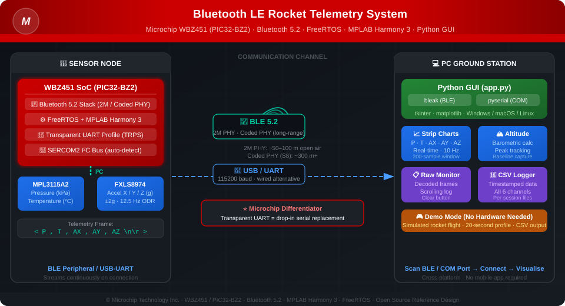

# Bluetooth LE Rocket Telemetry System Using Microchip WBZ451 / PIC32-BZ2

> **Real-time wireless sensor telemetry over Bluetooth 5.2 — pressure, temperature, and 3-axis acceleration streamed from a WBZ451 SoC to a Python desktop GUI over BLE or USB, with live strip charts, barometric altitude, and CSV data logging.**

[](https://www.microchip.com/en-us/product/WBZ451)
[](https://www.bluetooth.com/learn-about-bluetooth/tech-overview/)
[](https://www.freertos.org/)
[](https://www.python.org/)
[](https://www.microchip.com/)

---

## Table of Contents

- [What Is This Project?](#what-is-this-project)
- [System Architecture](#system-architecture)
- [Why WBZ451? — Comparison with nRF52, ESP32, CC2652](#why-wbz451--comparison-with-nrf52-esp32-cc2652)
- [Why You Need It](#why-you-need-it)
- [Application Use Cases](#application-use-cases)
- [Hardware Used](#hardware-used)
- [Software Stack](#software-stack)
- [Ground Station in Action](#ground-station-in-action)
- [Project Structure](#project-structure)
- [Launching the GUI — Step-by-Step](#launching-the-gui--step-by-step)
- [Firmware — How to Build and Flash](#firmware--how-to-build-and-flash)
- [Telemetry Protocol](#telemetry-protocol)
- [GUI Features](#gui-features)
- [Demo Mode — No Hardware Required](#demo-mode--no-hardware-required)
- [Frequently Asked Questions](#frequently-asked-questions)
- [Related Topics and SEO Keywords](#related-topics-and-seo-keywords)

---

## What Is This Project?

This project demonstrates a complete, end-to-end **wireless rocket telemetry system** built on the **Microchip WBZ451 (PIC32-BZ2)** Bluetooth 5.2 SoC. It is a production-quality reference design for any application that needs to stream multi-sensor data wirelessly from an embedded node to a PC in real time.

The **WBZ451 firmware** reads two sensors over I2C:

- **MPL3115A2** (NXP) — barometric pressure and temperature
- **FXLS8974** (NXP) — 3-axis accelerometer (±2 g, 12.5 Hz)

It encodes readings into compact ASCII frames and streams them continuously to a paired host using Microchip's **Transparent UART Profile (TRPS)** over BLE 5.2, or directly over a USB COM port when a USB-UART bridge is used.

The **Python desktop GUI** on the host receives, parses, and visualises the data:

- Real-time 5-channel strip charts (pressure, temperature, AX, AY, AZ)
- Barometric altitude calculated live from pressure and temperature
- Peak altitude tracking with user-defined baseline capture
- Scrolling raw data monitor
- One-click CSV data logging

---

## System Architecture

<p align="center">
  
</p>

<p align="center">
  <em>WBZ451 reads MPL3115A2 (pressure/temperature) and FXLS8974 (accelerometer) over I²C · encodes telemetry frames · streams over Bluetooth 5.2 or USB to the Python ground station GUI</em>
</p>

---

## Why WBZ451? — Comparison with nRF52, ESP32, CC2652

| Feature | **Microchip WBZ451** | Nordic nRF52840 | Espressif ESP32 | TI CC2652R |
|---|---|---|---|---|
| **Bluetooth version** | 5.2 | 5.4 | 5.0 | 5.1 |
| **2M PHY** | Yes | Yes | Yes | Yes |
| **Coded PHY (long-range)** | Yes | Yes | No | No |
| **Transparent UART profile** | Built-in (Microchip TRPS) | Requires custom profile | Requires custom | Requires custom |
| **UART → BLE migration** | Drop-in: serial code unchanged | Requires BLE stack rework | Requires rework | Requires rework |
| **IDE / framework** | MPLAB X + Harmony 3 | nRF Connect SDK + Zephyr | ESP-IDF / Arduino | Code Composer Studio |
| **RTOS** | FreeRTOS (built-in) | Zephyr (mandatory) | FreeRTOS optional | TI-RTOS / FreeRTOS |
| **Existing Microchip developer** | Zero learning curve | New toolchain required | New toolchain | New toolchain |
| **Industrial grade** | Yes | Consumer to industrial | Consumer-focused | Industrial |
| **Multi-role BLE** | Central + Peripheral + Broadcaster | Yes | Central or Peripheral | Yes |
| **Security** | BLE SMP, AES-128 | BLE SMP, AES-128, TrustZone | BLE SMP, AES | BLE SMP, AES |

**The key differentiator:** Microchip's **Transparent UART Profile (TRPS)** lets you treat BLE exactly like a serial UART. If your existing product already has UART-based communication, you can add wireless BLE connectivity to the WBZ451 without rewriting any application logic — something no competitor offers out of the box.

---

## Why You Need It

| Challenge | How This Project Solves It |
|---|---|
| Need wireless sensor data from a moving vehicle (rocket, drone, UAV) | Bluetooth 5.2 removes wires; WBZ451 handles the full certified BLE stack |
| Want live telemetry on a PC without writing a mobile app | Python GUI runs on Windows, macOS, or Linux with a single command |
| Need to log flight data for post-flight analysis | One-click CSV logging captures every frame with millisecond timestamps |
| Want to evaluate Microchip WBZ451 / PIC32-BZ2 for a product | Fully working MPLAB Harmony 3 firmware with FreeRTOS — production-ready starting point |
| Need a demo that runs without hardware | Built-in Demo Mode simulates a full rocket flight profile with real sensor physics |
| Already use Microchip PIC / SAME / SAMD in production | Zero toolchain change: MPLAB X, XC32, Harmony 3 — same ecosystem |

---

## Application Use Cases

This architecture applies directly to a wide range of real-world products and projects:

### Rocketry / High-Power Rocketry (HPR)
Monitor altitude, peak G-force, and flight phase (boost, coast, apogee, recovery) wirelessly. Log data for post-flight analysis and Tripoli/NAR certification documentation. Replace wired data recorders with a BLE node.

### Drone / UAV Telemetry
Stream IMU (accelerometer) and barometric altitude from a drone or fixed-wing UAV to a ground station over Bluetooth 5.2. Low latency 2M PHY for live monitoring; Coded PHY (S8) for extended range operations.

### Weather Balloon / High-Altitude Balloon (HAB)
Log pressure, temperature, and altitude throughout ascent and descent. Capture peak altitude. Download data live during line-of-sight phase via BLE, fall back to logged CSV for the full flight.

### Industrial IoT — Predictive Maintenance
Mount the WBZ451 sensor node on rotating machinery. Stream vibration (accelerometer) and temperature data to a PC monitoring station. Detect early-stage bearing failure, misalignment, or imbalance before catastrophic failure — reducing unplanned downtime in smart factories and Industry 4.0 deployments.

### Industrial Asset Tracking
Use BLE advertising + RSSI to locate assets on a factory floor, warehouse, or construction site. WBZ451's multi-role capability means a single device can be both a sensor node and a BLE scanner/gateway simultaneously.

### Environmental Monitoring
Deploy sensor nodes for air quality monitoring, climate monitoring, precision agriculture, or cold-chain temperature logging. The TRPS transparent channel means cloud integration (MQTT, AWS IoT, Azure IoT Hub) requires only a UART-to-cloud bridge.

### Wearable Devices / Health Monitoring
Adapt the accelerometer pipeline for step counting, fall detection, or impact monitoring in sports equipment or personal safety wearables. BLE 5.2 low-power modes extend battery life for coin-cell or small LiPo applications.

### Structural Health Monitoring
Attach wireless sensor nodes to bridges, pipelines, or buildings. Stream vibration and environmental data continuously. WBZ451's Coded PHY extends range through walls and structural materials.

### Educational STEM / University Projects
Teach students about embedded C, RTOS, BLE communication, sensor integration, barometric altitude, and real-time data visualisation — with a fully working hardware+software demo that needs no prior BLE experience to run.

### IoT Sensor Node Rapid Prototyping
The Transparent UART Profile acts as a generic serial-over-BLE channel. Swap any I2C/SPI/UART sensor in the firmware without touching the BLE stack or the GUI. Compress prototype-to-demo time from weeks to hours.

### Consumer Electronics Reference Design
Demonstrates Microchip's full BLE SDK, FreeRTOS integration, MPLAB Harmony 3 generated drivers, I2C sensor patterns, and power management — ready to carry forward into a product.

---

## Hardware Used

| Component | Part Number | Role |
|---|---|---|
| BLE SoC / MCU | **Microchip WBZ451** (PIC32-BZ2 family) | Runs firmware, BLE 5.2 stack, reads sensors over I2C |
| Pressure + Temperature Sensor | **NXP MPL3115A2** | Barometric pressure (Pa, Q18.2 format) and temperature (°C) |
| 3-Axis Accelerometer | **NXP FXLS8974** | Acceleration X/Y/Z in ±2 g range, 12.5 Hz ODR, 16-bit output |
| I2C Bus | SERCOM2 (WBZ451) | Both sensors on shared I2C bus |
| PC / Laptop | Windows / macOS / Linux | Runs the Python ground station GUI |
| BLE transport | Integrated in WBZ451 | 2.4 GHz Bluetooth 5.2; 2M PHY or Coded PHY |
| USB-UART bridge (optional) | CP2102 / CH340 / FTDI | Wired COM port alternative for development and debugging |

> **Sensor detection:** The firmware auto-detects both sensors at startup via I2C WHO_AM_I register verification (`0xC4` for MPL3115A2, `0x86`/`0x84` for FXLS8974). If either sensor is missing, the firmware reports the failure and halts sensor polling gracefully.

---

## Software Stack

### Firmware (WBZ451)

| Component | Details |
|---|---|
| IDE | **MPLAB X IDE** (free, Windows/macOS/Linux) |
| MCU Framework | **MPLAB Harmony 3** (generated peripheral drivers, middleware, BLE stack integration) |
| RTOS | **FreeRTOS** (task scheduling, queue-based event handling) |
| BLE Stack | **Microchip BLE SDK for PIC32-BZ2** (Bluetooth 5.2 certified) |
| BLE Profile | **Transparent UART Profile Server (TRPS)** — serial-over-BLE with no application-layer changes |
| Compiler | XC32 |
| Language | C |
| Project file | `Rocket_Telemetry/Rocket_Telemetry.X/` |

### Ground Station GUI

| Component | Details |
|---|---|
| Language | Python 3.9+ |
| GUI Framework | **tkinter** (standard library, no extra install) |
| Charts | **matplotlib** (embedded via `FigureCanvasTkAgg`) |
| BLE | **bleak** 0.22+ (cross-platform BLE library using OS-native BLE stack) |
| Serial / COM | **pyserial** 3.5+ |
| Data export | **csv** (standard library) |
| Packaging | **PyInstaller** (`.spec` file included for `.exe` generation) |

---

## Ground Station in Action

<p align="center">
  
</p>

<p align="center">
  <em>All four windows running in Demo Mode — Port &amp; BLE Connector (top-left) · Strip Chart with live P/T/AX/AY/AZ plots (top-right) · Altitude chart peaking at 327 m (bottom-left) · Raw Data Monitor with decoded telemetry frames (bottom-right)</em>
</p>

---

## Project Structure

```
Bluetooth-LE-Rocket-Telemetry-System-Using-PIC32-BZ-MCUs/
│
├── Rocket_Telemetry/                    ← WBZ451 firmware (MPLAB X)
│   ├── Rocket_Telemetry.X/              ← MPLAB X project files
│   └── src/
│       ├── app.c / app.h                ← Sensor init (MPL3115A2 + FXLS8974), state machine
│       ├── app_ble/                     ← BLE event handlers, TRPS handler, utility
│       ├── app_trps.c / app_trps.h      ← Transparent UART Profile server
│       └── config/default/              ← Harmony 3 generated BLE stack, FreeRTOS config
│
├── Rocket_Telemetry_GUI/                ← Python ground station GUI
│   ├── app.py                           ← All GUI + BLE + serial logic (~1500 lines)
│   ├── requirements.txt                 ← bleak, pyserial
│   ├── app.spec                         ← PyInstaller .exe build spec
│   ├── Microchip_logo.png               ← Footer logo
│   └── rocket.ico / rocket.png          ← App icons
│
└── Images/
    └── Rocket_Telemetry_GUI.png         ← GUI screenshot
```

---

## Launching the GUI — Step-by-Step

### Prerequisites

- Python 3.9 or later — download from [python.org](https://www.python.org/downloads/)
- The GUI folder at your chosen path (e.g., `d:\RocketGUI 2\RocketGUI`)
- For BLE: a PC with a Bluetooth 4.0+ adapter (built-in or USB dongle)
- For COM port: a USB-UART adapter connected to the WBZ451 UART pins

### Step 1 — Open a Terminal

**Windows:** Press `Win + R` → type `cmd` → press Enter.

### Step 2 — Navigate to the GUI Folder

```bat
cd "d:\RocketGUI 2\RocketGUI"
```

### Step 3 — Install Python Dependencies

```bat
pip install -r requirements.txt
pip install matplotlib
```

> Run this once. If you see "Requirement already satisfied", that is fine.

### Step 4 — Launch the GUI

```bat
python app.py
```

The **Port and BLE Connector** main window opens immediately.

### Step 5 — Connect to the WBZ451

**Via Bluetooth BLE:**
1. Select **Bluetooth BLE** under Transport.
2. Click **Scan BLE** — devices appear within a few seconds.
3. Select your WBZ451 device (e.g., `BLE_UART_DEMO`).
4. Click **Connect**.

**Via USB COM Port:**
1. Select **COM Port** under Transport.
2. Click **Scan COM** — your port appears (e.g., `COM15`).
3. Confirm Baud is `115200`.
4. Select the port and click **Connect**.

### Step 6 — Open Telemetry Windows

After connecting, use the **Windows** row of buttons:

| Button | Opens |
|---|---|
| Raw On/Off | Scrolling view of decoded telemetry frames |
| Chart On/Off | 5-channel strip chart: Pressure, Temperature, AX, AY, AZ |
| Altitude On/Off | Altitude chart with peak tracking and baseline capture |

### Step 7 — (Optional) Log Data to CSV

Click **Start Log** to write all telemetry to a timestamped `.csv` file in the GUI folder. Click **Stop Log** to close the file safely.

---

## Firmware — How to Build and Flash

1. Install **MPLAB X IDE** and **XC32 compiler** — both free from [microchip.com/mplab](https://www.microchip.com/en-us/tools-resources/develop/mplab-x-ide).
2. Open `Rocket_Telemetry/Rocket_Telemetry.X/` as an existing MPLAB X project.
3. Select **WBZ451** as the target device.
4. Build the project (`F11`).
5. Connect your WBZ451 board via the on-board PKOB debugger/programmer or an external MPLAB PICkit 4 / ICD 5.
6. Flash the device (`F6` — Make and Program Device).

After programming, the WBZ451 will:
- Auto-detect the MPL3115A2 and FXLS8974 over I2C.
- Begin BLE advertising as a Transparent UART peripheral.
- Stream `<P,T,AX,AY,AZ\n\r>` frames continuously once a central (your PC) connects.

> **Note for wired debugging:** The firmware also streams data on the SERCOM UART at 115200 baud. Connect a USB-UART adapter to the WBZ451 TX/RX pins to use the GUI without BLE.

---

## Telemetry Protocol

The WBZ451 transmits sensor data as **framed ASCII** over BLE Transparent UART (or UART):

```
<P,T,AX,AY,AZ\n\r>
```

| Field | Sensor | Unit | Example |
|---|---|---|---|
| `P` | MPL3115A2 | kPa | `101.325` |
| `T` | MPL3115A2 | °C | `24.500` |
| `AX` | FXLS8974 | g | `0.012` |
| `AY` | FXLS8974 | g | `-0.005` |
| `AZ` | FXLS8974 | g | `1.001` |

**Frame boundaries:** `<` marks the start; `\n\r` marks the end. The GUI buffers the raw byte stream and extracts complete frames, automatically discarding partial frames from connection startup.

**Altitude calculation** — hypsometric / barometric formula:

```
altitude_m = (R × T_K / g) × ln(P0 / P)

where:
  R  = 287.05  J/(kg·K)  dry air specific gas constant
  T_K = temperature in Kelvin (T_°C + 273.15)
  g  = 9.80665 m/s²
  P0 = 101325  Pa  sea-level standard pressure
  P  = measured pressure in Pa
```

---

## GUI Features

| Feature | Description |
|---|---|
| **BLE scan + connect** | Discovers all nearby BLE peripherals; subscribes to all notify/indicate characteristics automatically |
| **COM port scan + connect** | Auto-discovers available COM ports; supports any baud rate |
| **Strip chart — 5 channels** | Real-time scrolling plots, 200-sample rolling window, configurable Y-axis min/max per channel |
| **Auto Range** | One-click Y-axis scaling based on actual data range |
| **Altitude chart** | Barometric altitude in metres; peak altitude label; "Capture Start" zeroes the baseline for relative altitude |
| **Raw data monitor** | Scrolling decoded frame log; Clear button |
| **CSV logging** | Columns: `Timestamp, P_kPa, T_degC, AX_g, AY_g, AZ_g, Altitude_m`; new file per session |
| **Demo mode** | Fully simulated rocket flight — no hardware needed |
| **Clean disconnect** | Stops BLE notifications properly, closes sub-windows, flushes log file |

---

## Demo Mode — No Hardware Required

Click **Demo Start** from the main window to run a simulated rocket flight without any hardware:

1. A 200-row flight CSV is generated internally using real barometric physics.
2. Raw Data Monitor, Strip Chart, and Altitude windows open automatically.
3. One telemetry frame plays every 100 ms (10 Hz) over 20 seconds.
4. **Flight profile:** boost phase (0–5 s, high AZ ~3.5 g) → coast phase (5–10 s) → apogee (~327 m / 1073 ft at t=12 s) → descent back to ground.
5. Demo stops automatically; CSV file is saved to disk.

**Ideal for:** trade show demonstrations, classroom teaching, GUI evaluation before hardware is ready, and user training.

---

## Frequently Asked Questions

**Q: Can I use a different BLE chip (nRF52, ESP32, CC2340)?**  
A: Yes. The GUI is chip-agnostic. Any BLE device that sends the `<P,T,AX,AY,AZ\n\r>` frame format over a notify characteristic will work. The WBZ451's Transparent UART Profile maps cleanly to this because it exposes a standard notify characteristic for upstream data.

**Q: What Python version is required?**  
A: Python 3.9 or later. Check: `python --version` in a terminal.

**Q: Can I build a standalone Windows .exe so users don't need Python?**  
A: Yes. A PyInstaller spec file (`app.spec`) is included. Run `pyinstaller app.spec` in the GUI folder to produce a single-file executable — no Python installation needed on the end-user machine.

**Q: Can I replace the sensors with different I2C devices?**  
A: Yes. Edit `app.c` in the firmware to initialise and read your sensors, then format the values into the same ASCII frame. No changes to the BLE stack or the GUI are needed as long as the frame format is preserved.

**Q: What is the BLE range of the WBZ451?**  
A: Bluetooth 5.2 with 2M PHY typically achieves 50–100 m in open air. Switching to Coded PHY (S8) can extend range to several hundred metres at reduced throughput — useful for outdoor rocketry or HAB applications.

**Q: Can I log multiple flights in one GUI session?**  
A: Yes. Each click of **Start Log** creates a new timestamped CSV file (e.g., `log_20261013_143022_001.csv`). Existing files are never overwritten.

**Q: Does the WBZ451 need an external BLE antenna?**  
A: WBZ451-based modules typically include an integrated chip antenna or a u.FL connector for an external antenna. Check your specific module's datasheet for antenna options.

**Q: How do I integrate this into an MQTT / cloud IoT pipeline?**  
A: The Transparent UART Profile is a serial bridge. On the host side, replace the GUI with a Python script that publishes each parsed frame to an MQTT broker (e.g., AWS IoT Core, Azure IoT Hub, Mosquitto). The WBZ451 firmware requires no changes.

---

## Related Topics and SEO Keywords

### Microchip / WBZ451 Ecosystem
Microchip WBZ451 · PIC32-BZ2 · PIC32BZ · WBZ451 Curiosity Board · MPLAB Harmony 3 · MPLAB X IDE · XC32 compiler · Microchip BLE SDK · Transparent UART Profile · TRPS · BLE_TRSPS · Microchip wireless IoT · Microchip BLE 5.2 · Microchip FreeRTOS · Microchip sensor hub · Microchip SERCOM I2C · MPLAB Harmony wireless · PIC32 Bluetooth · WBZ351 · PIC32-BZ

### Bluetooth Low Energy — Core Technical
Bluetooth Low Energy · BLE 5.2 · Bluetooth 5 · 2M PHY · Coded PHY · LE Coded PHY · S2 coding · S8 coding · long-range BLE · extended range Bluetooth · GATT profile · GATT server · GATT client · BLE notify · BLE indicate · BLE advertising · BLE connection parameters · BLE MTU · BLE throughput · BLE latency · BLE security · BLE SMP · BLE pairing · BLE bonding · AES-128 BLE · BLE central · BLE peripheral · BLE broadcaster · multi-role BLE · multi-link BLE · BLE mesh · BLE Mesh networking · Bluetooth SIG · Bluetooth certification · BLE stack · NimBLE · host controller interface HCI · GATT characteristic · BLE service UUID · ATT protocol · L2CAP BLE

### Sensors and Embedded
MPL3115A2 · FXLS8974 · barometric pressure sensor · altimeter sensor · accelerometer I2C · 3-axis accelerometer · IMU Bluetooth · inertial measurement unit wireless · I2C sensor node · SERCOM I2C · embedded sensor hub · FreeRTOS sensor · real-time sensor acquisition · embedded telemetry

### Data Streaming and Wireless Protocols
BLE data streaming · real-time sensor data streaming · wireless data acquisition · UART to BLE · serial to Bluetooth · Transparent UART BLE · serial over BLE · wireless serial port · BLE to PC · BLE COM port replacement · BLE UART bridge · Python BLE · bleak Python · pyserial · BLE sensor to PC · wireless sensor interface · Bluetooth data logger

### Altitude, Rocketry, and Flight
rocket telemetry · model rocket data logger · high-power rocketry HPR · rocketry flight computer · amateur rocketry · barometric altitude · hypsometric formula · altitude from pressure · peak altitude tracking · apogee detection · rocket accelerometer · flight data recorder · NAR Tripoli rocketry · EX rocketry · two-stage rocket · rocket staging · recovery altimeter · ejection charge altimeter · COTS altimeter · GPS-free altitude

### Drone and UAV
drone telemetry · UAV sensor data link · unmanned aerial vehicle BLE · quadcopter sensor · fixed-wing UAV telemetry · drone flight data · IMU drone · barometric altitude drone · drone ground station · drone data acquisition · UAV ground control · sUAS sensors · FPV telemetry · MAVLink alternative

### Industrial IoT and Industry 4.0
industrial IoT · IIoT · Industry 4.0 · smart factory · predictive maintenance · condition monitoring · vibration monitoring · bearing vibration analysis · machine health monitoring · equipment monitoring IoT · industrial asset tracking · RTLS real-time location system · indoor positioning BLE · BLE beacon · proximity sensing · iBeacon · Eddystone · BLE gateway · IoT gateway · MQTT BLE bridge · OPC UA BLE · Modbus BLE · industrial wireless sensor · rugged wireless sensor · wireless I/O · BLE for SCADA

### Environmental Monitoring
environmental sensor · air quality monitoring · temperature humidity monitoring · weather station IoT · climate monitoring · precision agriculture IoT · greenhouse monitoring · cold-chain monitoring · food safety IoT · water quality sensor BLE · CO2 sensor wireless · particulate matter sensor wireless · indoor air quality IAQ

### Wearable and Health
wearable Bluetooth · BLE wearable · health monitoring wearable · fitness tracker BLE · smart band · fall detection sensor · activity monitoring · biometric sensor wireless · medical IoT · remote patient monitoring · BLE heart rate · BLE pulse oximeter · sports performance monitoring

### Asset Tracking and Smart Building
asset tracking Bluetooth · BLE asset tracker · warehouse inventory tracking · smart building IoT · HVAC monitoring BLE · occupancy sensing · energy monitoring IoT · access control BLE · smart lock Bluetooth · building automation BLE

### Python and Developer Tools
Python BLE · bleak library · pyserial · Python tkinter GUI · matplotlib real-time · Python data logger · Python sensor dashboard · Python COM port · Python async BLE · asyncio BLE · Python IoT · Python MQTT · Python CSV logger · PyInstaller executable

### Competitor Comparison Keywords (Customers searching alternatives)
WBZ451 vs nRF52840 · WBZ451 vs nRF5340 · Microchip BLE vs Nordic Semiconductor · PIC32 BLE vs ESP32 · WBZ451 vs TI CC2652 · WBZ451 vs Silicon Labs EFR32BG · best BLE SoC for IoT · best BLE microcontroller 2024 · BLE SoC comparison · nRF52 alternative · ESP32 BLE alternative · Nordic vs Microchip BLE · low-power BLE SoC comparison · industrial BLE SoC · easiest BLE development kit · BLE development board beginner · fastest UART to BLE migration · replace serial with BLE · UART to wireless migration

### High-Altitude Balloon and Space
high-altitude balloon HAB · weather balloon payload · stratospheric balloon · balloon telemetry · near-space payload · CubeSat sensor · CanSat · nanosatellite sensor · STEM aerospace project

### Education and STEM
STEM electronics project · university IoT project · embedded systems tutorial · BLE tutorial for beginners · wireless sensor network tutorial · real-time data visualisation Python · sensor data science · data acquisition system · electronics engineering project · Bluetooth project Arduino alternative · microcontroller wireless

---

*© 2026 Microchip Technology Inc. and its subsidiaries. Firmware source files are subject to Microchip's standard software license. See individual source file headers for full license text.*
